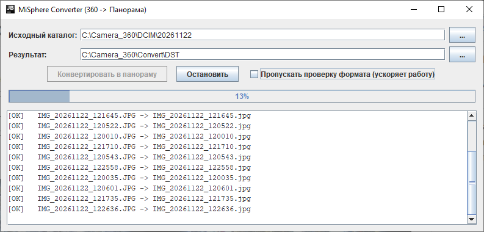
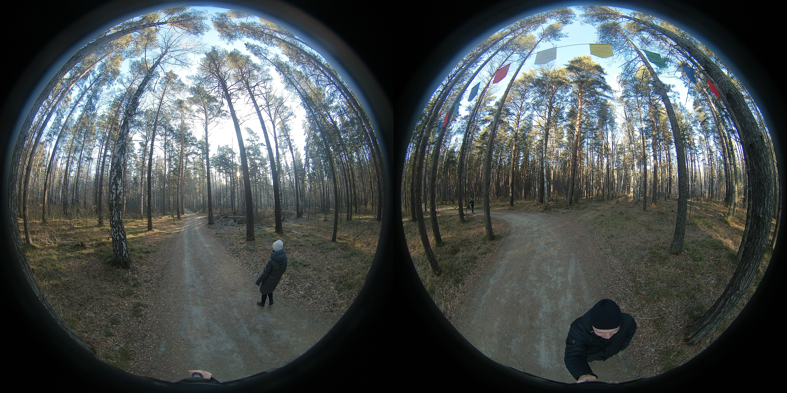
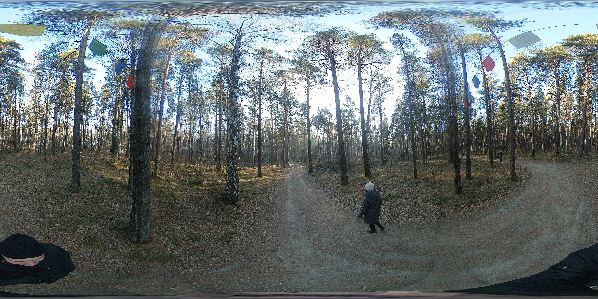

# MiSphereConverter (360° Fisheye to Panorama)

Кроссплатформенное приложение на Java (Windows / Linux) для пакетной и одиночной конвертации фотографий, полученных с двухобъективных 360-камер (два кадра «рыбий глаз»), в единое плоское панорамное изображение (Equirectangular projection) в формате JPEG.

Приложение разработано как десктопный аналог оригинального Android-приложения, использует математический аппарат **OpenCV** для развертки и бесшовной склейки кадров.



### Исходное фото


### Переработанное фото


## 🚀 Основные возможности

*   **Три режима работы:**
    *   **GUI (Графический интерфейс):** Удобно для ручной пакетной обработки.
    *   **CLI (Командная строка):** Идеально для автоматизации, скриптов и серверов без графической оболочки.
    *   **Библиотека:** Возможность встраивать логику конвертации в другие Java-проекты (работа с бинарными потоками).
*   **Пакетная обработка:** Рекурсивный обход выбранной директории. Поддерживается вложенность любой глубины.
*   **Умная проверка (в GUI):** Предварительный анализ углов изображения для отсеивания уже готовых панорам или обычных фото. Проверку можно отключить для ускорения работы.
*   **Сохранение структуры папок:** Результаты конвертации сохраняются в новый каталог с полным сохранением исходной структуры подкаталогов (недостающие папки создаются автоматически).
*   **Бесшовная склейка:** Использование перекрытия (FOV 195°) и альфа-смешивания (Feathering) для устранения видимых швов и перепадов яркости на стыке двух объективов.
*   **Кроссплатформенность:** Работает как на Windows 10, так и на Linux (благодаря кроссплатформенному OpenCV и Java NIO).
*   **Сохранение настроек:** GUI-приложение запоминает последние выбранные папки и настройки при следующем запуске.

## 🛠 Используемые технологии

*   **Java 21**
*   **Swing** (Графический интерфейс пользователя)
*   **OpenCV** (`org.openpnp:opencv:4.9.0-0`) — для работы с матрицами изображений, ремаппинга (проекционных преобразований) и смешивания слоев.
*   **Maven** — сборка проекта и управление зависимостями.

## 📦 Сборка и запуск

### Требования
*   Установленный JDK 21+
*   Apache Maven

### Сборка
В корневой папке проекта выполните команду:
```bash
mvn clean package
```
После успешной сборки в папке `target/` появится исполняемый JAR-файл (например, `MiSphereConverter-1.0-SNAPSHOT.jar`).

---

## 📖 Инструкция по использованию

### 1. Графический интерфейс (GUI)
Для запуска без параметров просто выполните:
```bash
java -jar target/MiSphereConverter-1.0-SNAPSHOT.jar
```
1. Нажмите кнопку `...` напротив поля **«Исходный каталог»** и выберите папку с исходными фотографиями (`*.jpg`, `*.png`).
2. Нажмите кнопку `...` напротив поля **«Результат»** и выберите папку для сохранения панорам.
3. (Опционально) Снимите галочку **«Пропускать проверку формата»**, если хотите, чтобы приложение отсеивало файлы, не являющиеся сырыми кадрами 360.
4. Нажмите **«Конвертировать в панораму»**. Процесс можно прервать кнопкой **«Остановить»**.

### 2. Консольный режим (CLI)
Если при запуске передать аргументы, приложение работает без графического интерфейса. 
Использование: `java -jar app.jar <входной_путь> [выходной_путь]`

**Пример 1: Конвертация одного файла (автогенерация имени)**
Результат сохранится в той же папке с префиксом `pano_`.
```bash
java -jar target/MiSphereConverter-1.0-SNAPSHOT.jar /home/user/photo/IMG_001.jpg
# Результат: /home/user/photo/pano_IMG_001.jpg
```

**Пример 2: Конвертация одного файла (с указанием результата)**
```bash
java -jar target/MiSphereConverter-1.0-SNAPSHOT.jar /home/user/photo/IMG_001.jpg /home/user/out/result.jpg
```

**Пример 3: Конвертация каталога (сохранение в ту же папку)**
Все файлы в папке и подпапках будут обработаны, результаты сохранятся рядом с префиксом `pano_`. Уже сконвертированные файлы (с префиксом) будут проигнорированы.
```bash
java -jar target/MiSphereConverter-1.0-SNAPSHOT.jar /home/user/photos/
```

**Пример 4: Конвертация каталога в другой каталог (с сохранением структуры)**
```bash
java -jar target/MiSphereConverter-1.0-SNAPSHOT.jar /home/user/photos/ /home/user/panoramas/
```

### 3. Использование как библиотеки
Проект можно добавить как Maven-зависимость и использовать класс `FisheyeConverter` (реализует `BinaryConverter`) для обработки бинарных данных без привязки к файловой системе.

```java
import ru.miacomsoft.FisheyeConverter;
import java.io.*;

public class Example {
    public static void main(String[] args) throws IOException {
        FisheyeConverter converter = new FisheyeConverter();
        
        try (InputStream in = new FileInputStream("dual_fisheye.jpg");
             OutputStream out = new FileOutputStream("panorama.jpg")) {
             
            // checkFormat = true (проверять, что это рыбий глаз)
            // logCallback = System.out::println (вывод логов)
            converter.convertStream(in, out, true, System.out::println);
        }
    }
}
```

### Пример асинхронного использования в вашем проекте

Теперь вы можете вызывать конвертацию, не блокируя основной поток программы, и передавать функцию-колбэк, которая сработает по завершении.

**Пример 1: Асинхронная конвертация файла в файл (самый безопасный и удобный способ)**
```java
import ru.miacomsoft.FisheyeConverter;
import java.nio.file.Path;

public class AsyncExample {
    public static void main(String[] args) {
        FisheyeConverter converter = new FisheyeConverter();
        
        Path source = Path.of("dual_fisheye.jpg");
        Path target = Path.of("panorama.jpg");

        System.out.println("Запуск конвертации в фоне...");

        // Запускаем асинхронно, передаем колбэк, который выполнится после завершения
        converter.convertFileAsync(
            source, 
            target, 
            true, 
            System.out::println, // Логи
            () -> System.out.println("=== Колбэк: Конвертация полностью завершена! ===") // Колбэк onFinish
        );
        
        System.out.println("Программа продолжает работать, не дожидаясь конвертации...");
        
        // Чтобы программа не закрылась сразу (так как CompletableFuture использует демон-потоки), 
        // можно добавить небольшую задержку или ожидание.
        try { Thread.sleep(5000); } catch (InterruptedException e) {}
    }
}
```

**Пример 2: Асинхронная конвертация байтового массива (для сложных интеграций)**
```java
import ru.miacomsoft.FisheyeConverter;
import java.nio.file.Files;
import java.nio.file.Path;

public class AsyncBytesExample {
    public static void main(String[] args) throws Exception {
        FisheyeConverter converter = new FisheyeConverter();
        byte[] rawData = Files.readAllBytes(Path.of("dual_fisheye.jpg"));

        // Передаем колбэки: что делать при успехе, что при ошибке
        converter.convertAsync(
            rawData,
            true,
            System.out::println,
            (resultBytes) -> {
                try {
                    Files.write(Path.of("panorama_async.jpg"), resultBytes);
                    System.out.println("Успех: файл сохранен!");
                } catch (Exception e) {
                    e.printStackTrace();
                }
            },
            (throwable) -> System.err.println("Ошибка конвертации: " + throwable.getMessage())
        );
    }
}
```

---

## 🧠 Как работает алгоритм развертки

1.  Исходное изображение делится пополам (левый и правый объектив).
2.  Для каждого пикселя целевой панорамы (соотношение 2:1) вычисляются 3D-координаты (широта и долгота).
3.  Вычисляется, в какой объектив смотрит вектор направления (передний или задний).
4.  С помощью обратной сферической проекции («рыбий глаз») вычисляются координаты пикселя на исходной линзе.
5.  OpenCV применяет карту искажений (`remap`). Карты кэшируются в памяти, чтобы не пересчитывать тригонометрию для каждой фотографии (сильно ускоряет пакетную обработку).
6.  В зоне стыка применяется плавная маска смешивания, чтобы избежать видимых швов из-за разницы экспозиции линз.

## 📂 Структура проекта

*   `Main.java` — точка входа, определение режима (GUI или CLI).
*   `CliRunner.java` — логика консольного режима (разбор аргументов, файлы, папки, префиксы).
*   `ConverterFrame.java` — графический интерфейс, логика работы с настройками и потоками.
*   `DirectoryConverter.java` — логика рекурсивного обхода файлов (многопоточная), создания структуры папок и применения префиксов.
*   `FileConverter.java` — интерфейс для конвертации файлов.
*   `BinaryConverter.java` — интерфейс для конвертации потоков (библиотечное использование).
*   `FisheyeConverter.java` — математическое ядро на OpenCV для развертки рыбий глаз и склейки.
